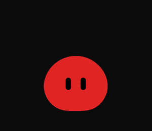
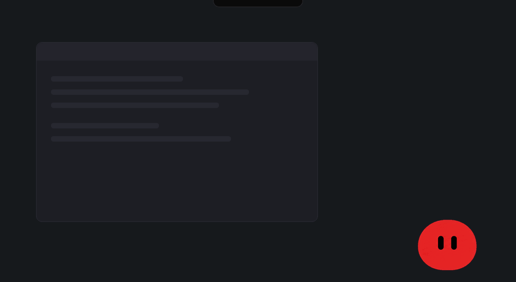
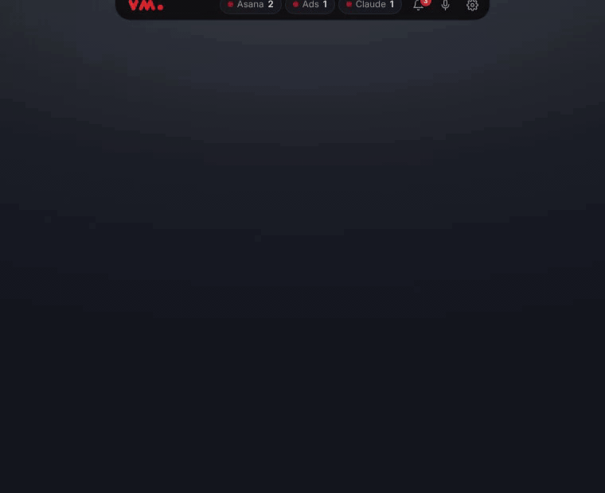
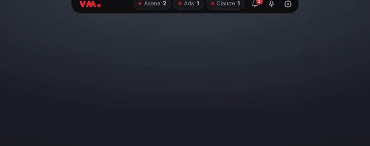
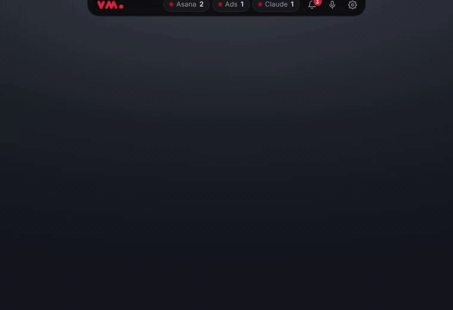
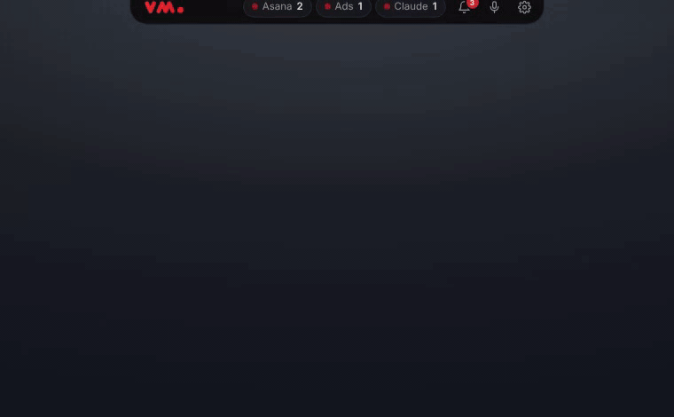
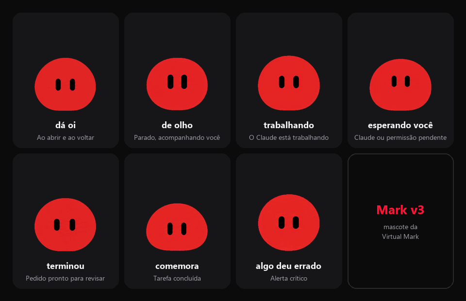

  

<h1 align="center">Mark</h1>

  O assistente de mesa da <b>Virtual Mark</b>: uma barra no topo da tela que junta Asana, Google Ads e Claude Code, 
  e o Mark, que fica no canto da tela e avisa quando algo precisa de você.

  <a href="https://github.com/RParagon/mark-releases/releases/latest"><b>⬇ Baixar a versão mais nova para Windows</b></a>

---

  
   Demonstração com dados fictícios.

## O que o Mark faz

O Mark fica quieto no canto da tela e só chama quando faz diferença. Ele não usa IA para decidir: segue regras simples que você mesmo ajusta.

| | |
|---|---|
| **Barra no topo** | Colada na borda de cima da tela, como um notch. Parada, recolhe numa lingueta; com o mouse por cima, abre. Mostra Asana, Google Ads e Claude Code num relance, e o clique passa pela área vazia em volta. |
| **Asana** | Suas tarefas do dia, com foco de hoje (automático ou escolhido por você, até 3), atrasadas, próximos 7 dias, sem prazo e por projeto. Abra uma tarefa na própria barra para ver descrição, subtarefas e comentários, mudar prazo, responsável, projeto e seção, comentar marcando pessoas com @, adiar ou concluir. |
| **Nova tarefa em 2 segundos** | `Ctrl+Alt+A` em qualquer lugar: escreva *"Revisar negativas amanhã #Projeto @Pessoa"* e a tarefa é criada com prazo, projeto e responsável. |
| **Google Ads** | Cada conta da MCC com gasto do dia, ritmo do mês, CPA e minigráfico de 7 dias. Abra uma conta para ver as campanhas, as perdas por orçamento e por classificação, os termos que gastaram sem converter e o relatório pronto para o cliente. Alertas de conta sem veicular, gasto acima do orçamento, anúncio reprovado, CPA subindo, medição parada e faturamento. |
| **Ações no Ads (opcional)** | Pausar ou ativar campanha, mudar orçamento (com limite por vez) e adicionar negativas, sempre com prévia do antes e depois, só com o seu clique e com "desfazer". Vem desligado; cada pessoa liga no próprio PC. |
| **Claude Code** | Cada conversa vira um cartão: o pedido, o que ele está fazendo, os arquivos editados e o estado. Responda os pedidos de permissão pela barra (Permitir, Permitir sempre, Negar), receba aviso quando ele termina e volte para a conversa com um clique. |
| **Avisos** | Três níveis: crítico (notificação do Windows com botões), importante (na barra) e informativo (só na central). Central de avisos com "Agora" no topo, histórico de 7 dias, horários de silêncio, silêncio automático em tela cheia e resumos de bom dia e de fim do dia. |
| **Modo ampliado** | Tarefa, conta do Ads, avisos e Configurações abrem numa barra larga e alta para ler com calma. |
| **Voz (em teste)** | `Ctrl+Alt+M` para falar com o Mark; ele responde falando. |

## Veja em ação

Gravado na própria barra do Mark, com dados de exemplo.

**Abrir uma tarefa e ampliar para ler com calma**

**Nova tarefa escrevendo do jeito que se fala**

**Google Ads: o alerta e a conta por dentro**

**Claude Code pedindo permissão na barra**

## Os estados do Mark

O Mark reage ao que está acontecendo: dá oi quando abre, fica de olho no cursor, corre quando o Claude está trabalhando, chama quando algo espera por você e comemora quando você conclui uma tarefa. Também dá para minimizá-lo: ele vira o ponto do logo **vm.** na barra e continua reagindo dali.

  

## Instalar

1. Baixe o `Mark_x.y.z_x64-setup.exe` da [versão mais nova](https://github.com/RParagon/mark-releases/releases/latest).
2. Abra o instalador. Se aparecer **"O Windows protegeu o computador"**, clique em **Mais informações → Executar assim mesmo** (o instalador ainda não tem certificado de código).
3. O Mark abre sozinho e a barra mostra os **Primeiros passos**:
   - **Seu nome**: como o Mark te chama (vem do Asana se ficar vazio).
   - **Asana**: cole o seu token pessoal (Asana → Configurações → Apps → Tokens de acesso pessoal). O link e o passo a passo estão na própria tela.
   - **Google Ads** (opcional): importe o convite da equipe e clique em **Entrar com Google** com a sua conta que tem acesso à MCC.
   - **Claude Code** (opcional): se ele estiver instalado no PC, um botão liga o Mark às suas conversas.

Pronto. A partir daí o Mark se atualiza sozinho.

## Atualizações

O Mark procura versão nova ao abrir e a cada 6 horas. Quando houver, aparece **"Atualizar para x.y.z"** na barra; clicando, você lê as novidades e instala com um clique. O Mark reinicia já na versão nova, com as suas configurações.

Cada versão é assinada, e o Mark só instala atualizações com essa assinatura. As notas de todas as versões estão em [Releases](https://github.com/RParagon/mark-releases/releases).

## Atalhos

| Atalho | O que faz |
|---|---|
| `Ctrl+Alt+A` | Nova tarefa no Asana |
| `Ctrl+Alt+M` | Falar com o Mark (voz) |
| Botão direito no Mark | Minimizar na barra, abrir a barra, Configurações, pausar alertas, sair |
| Ícone na bandeja | Configurações, trazer o Mark de volta, modo foco, testar avisos, sair |

## Privacidade e segurança

- Tokens e credenciais ficam no **Gerenciador de Credenciais do Windows**, nunca em arquivo.
- O Mark fala direto com o Asana e o Google Ads, com o seu acesso, e com o GitHub para buscar atualizações. A voz neural (Azure ou OpenAI) só é usada se você configurar a sua chave. Nada passa por servidores da Virtual Mark.
- No Google Ads, cada pessoa entra com a própria conta Google. O convite da equipe não carrega a credencial de ninguém.
- Toda ação que muda algo no Asana ou no Google Ads mostra antes o que vai mudar e só acontece com o seu clique.

## Problemas comuns

| Sintoma | O que fazer |
|---|---|
| "O Windows protegeu o computador" ao instalar | Mais informações → Executar assim mesmo. |
| O Google Ads parou depois de alguns dias | Configurações → Google Ads → **Entrar com Google** de novo. |
| A barra sumiu ou o Mark saiu da tela | Ícone da bandeja → **Trazer o Mark de volta**, ou feche e abra o Mark. |
| O Claude não aparece na barra | Configurações → Claude Code → **Instalar hooks** e abra uma conversa nova. |
| Quero silêncio agora | Ícone da bandeja → **Modo foco por 1 hora** (só passam os críticos). |

---

  O Mark é feito pela <b>Virtual Mark</b>. O personagem, os sons e o visual são da Virtual Mark. 
  A ideia da barra no topo e a técnica de acompanhar o Claude Code por hooks vêm do <a href="https://github.com/Louis-CFM/coucou">Coucou</a> (MIT).

